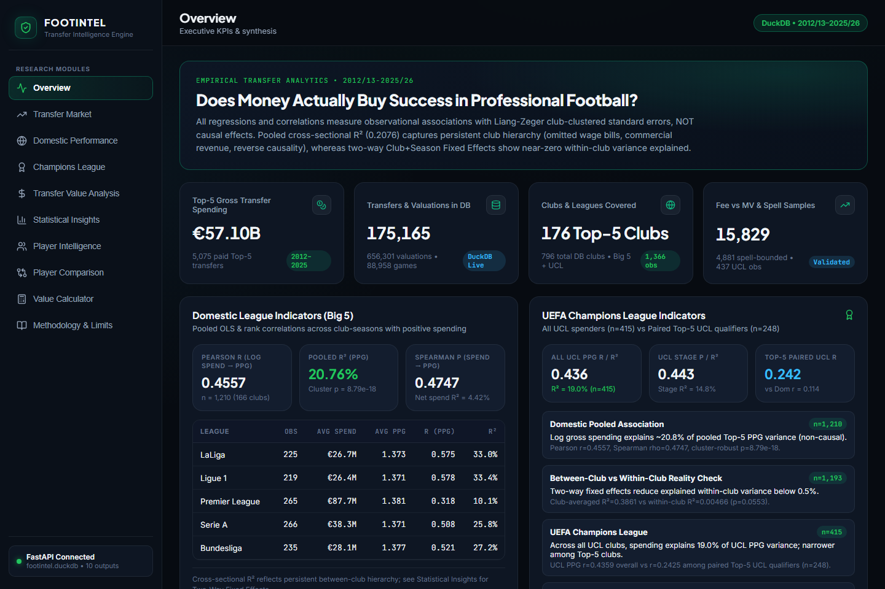
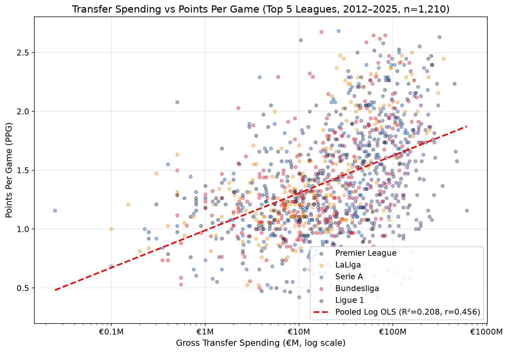
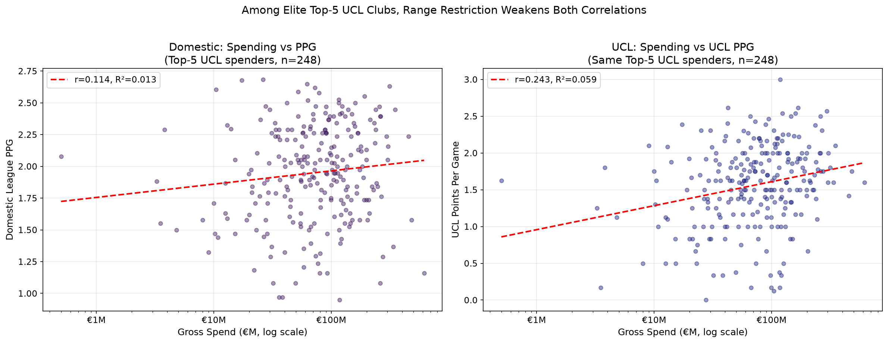
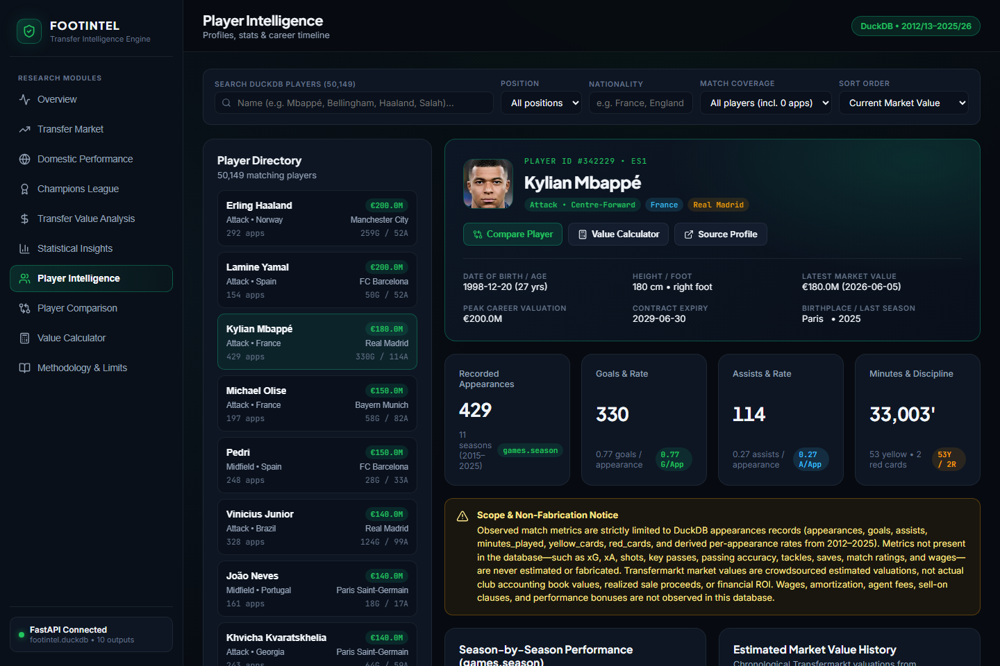
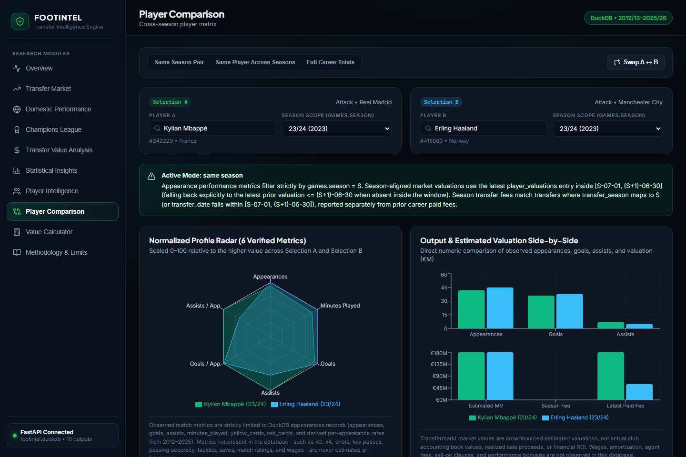
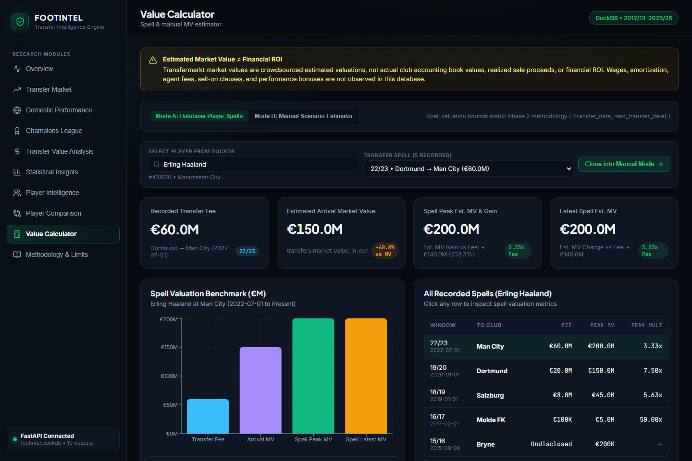

# FootIntel — Does Money Actually Buy Football Success?

**An end-to-end football transfer economics, econometric research, and full-stack analytics platform built with DuckDB, SQL, Python, FastAPI, React 19, and TypeScript.**


FootIntel combines a 9-table **DuckDB + SQL** warehouse (`175,165` transfers, `88,958` matches, `50,149` players, `656,301` market valuations), a **SciPy/Pandas** econometric engine with club-clustered standard errors and fixed-effects checks, a **FastAPI** REST API (`15` routes), and a **10-module interactive React dashboard** spanning macro league research, player intelligence, cross-season player comparison, and transfer-spell value lookup.



---

## Research Question

> **"Does Money Actually Buy Football Success?"**

Raw scatter plots suggest transfer spending strongly predicts league points. FootIntel tests whether that relationship holds up when normalized across leagues (`ppg`, `pos_pct`), tested across domestic vs. UEFA Champions League competition (`Steiger's z-test`), evaluated against **club and two-way fixed effects**, and audited for historical cohort bias (`last_season >= 2023`).

---

## Executive Summary: Key Empirical Findings

*All estimates come from [`backend/analysis/run_all.py`](backend/analysis/run_all.py) on the `2012/13–2025/26` snapshot (`n = 1,366` Top-5 club-seasons across `176` clubs; `€57.10B` across `5,075` paid Top-5 transfers). **All models measure observational associations, not causal effects.***

1. **Pooled Correlation Overstates Spending Impact (`R² = 0.2076` vs. Two-Way FE `R² = 0.00466`):**
   - Across Top-5 club-seasons with positive spending (`n = 1,210`, `166` clubs), `log(gross_spend_m)` correlates moderately with Points Per Game (`r = 0.4557`, `R² = 0.2076`, cluster-robust `p = 8.79e-18`; Spearman `ρ = 0.4747`, `p = 5.02e-69`). Net spend is weaker (`R² = 0.0442`, `r = 0.2101`, `n = 1,366`).
   - Club-averaged cross-sections reach `R² = 0.3861` (`r = 0.6214`, `166` clubs). **However, adding fixed effects collapses within-club explanatory power**: Club Fixed Effects yield `within R² = 0.0002` (`p = 0.7447`), and Two-Way (Club + Season) Fixed Effects yield `within R² = 0.00466` (`cluster_p = 0.0553`, `n = 1,193`). Persistent structural hierarchy (unobserved wage bills, commercial revenue, UCL revenue feedback) drives most of the pooled correlation.
2. **Big Five League Heterogeneity (`3.3x` Gap in Explanatory Power):**
   - Gross spending explains roughly a third of PPG variance in **Ligue 1** (`R² = 0.3336`, `r = 0.5776`, `n = 219`) and **LaLiga** (`R² = 0.3304`, `r = 0.5748`, `n = 225`), followed by **Bundesliga** (`R² = 0.2719`, `n = 235`) and **Serie A** (`R² = 0.2584`, `n = 266`).
   - In the **Premier League**, broad spending depth compresses returns (`R² = 0.1013`, `r = 0.3183`, `n = 265`).
3. **Domestic vs. UEFA Champions League (`Steiger's z = -2.17, p = 0.0299`):**
   - Out of `437` total UCL club-season records (`258` Top-5, `179` non-Top-5), econometric log-spend models restrict to `n = 415` positive-spend observations (`90` clubs; `22` zero-spend rows excluded), where spending explains `19.0%` of UCL PPG variance (`r = 0.4359`) and `14.85%` of knockout stage progression (`r = 0.3853`).
   - Among `248` paired Top-5 UCL spenders observed in both competitions in the same season (`258` total paired Top-5 UCL qualifiers minus `10` zero-spend rows), range restriction narrows both correlations (`r = 0.1141` domestic PPG vs. `r = 0.2425` UCL PPG), with a statistically significant difference favoring UCL PPG (`z = -2.1713`, `p = 0.0299`; stage difference `z = -0.538`, `p = 0.5906`).
4. **Transfer Fees vs. Arrival Market Valuations (`n = 15,829`, `R² = 0.6579`):**
   - Paid transfer fees track crowdsourced market valuations closely in log-log space (`R² = 0.6579`, `r = 0.8111`, Spearman `ρ = 0.8126`, cluster-robust OLS slope `0.9399`).
   - Clubs pay at or below arrival market value more often than above: median fee/MV ratio is `0.9333` (`51.65%` underpay, `42.55%` overpay, `5.8%` exact match).
5. **Spell-Bounded Player Valuations (`n = 4,881` Top-5 Paid Spells):**
   - Bounding `player_valuations` to `[transfer_date, next_transfer_date)` prevents valuation leakage across club spells. *Estimated Market Value Gain reflects Transfermarkt crowdsourced valuations—**not** club accounting profit or financial ROI (wages, agent fees, and amortization are unobserved).*

<p align="center">
  
  
</p>

---

## Dashboard Features (10 Interactive Modules)

All 10 views are accessible via the sidebar and deep-linked via URL hash in [`frontend/src/App.tsx`](frontend/src/App.tsx):

| # | Module | Hash Route | Purpose & Interactive Capabilities |
|---|---|---|---|
| 1 | **Overview** | `#overview` | Executive KPIs (`€57.10B`, `175,165` transfers, `176` clubs), Big-5 table, UCL indicators, key findings |
| 2 | **Transfer Market** | `#market` | Multi-season Big-5 spending series paired with historical player cohort coverage warnings (`16.7% → 100.0%`) |
| 3 | **Domestic Performance** | `#domestic` | Filterable Top-5 club-seasons, `gross_spend` / `net_spend` / `ppg` / `pos_pct`, league-by-league OLS slopes |
| 4 | **Champions League** | `#ucl` | All-UCL vs. Top-5 stage progression (`Group/League Phase` to `Winner`), paired domestic-vs-UCL Steiger tests |
| 5 | **Transfer Value Analysis** | `#value` | Fee-vs-arrival MV scatter, club valuation portfolios, and `4,881` spell-bounded player MV gain tables |
| 6 | **Statistical Insights** | `#statistics` | Full econometric battery: naive vs. Liang-Zeger clustered SEs, Club & Two-Way FE, sub-period & `asinh` checks |
| 7 | **Player Intelligence** | `#players` | Search `50,149` players; inspect bio profile, career appearances, season split table, MV timeline, club spells |
| 8 | **Player Comparison** | `#player-compare` | Side-by-side Same-Season, Cross-Season (same player), or Career comparison with normalized 6-axis radar & bars |
| 9 | **Value Calculator** | `#calculator` | Two modes: real database transfer-spell valuation lookup (`[transfer_date, next_transfer_date)`) & manual estimator |
| 10 | **Methodology & Limits** | `#methodology` | Built-in reference for season harmonization, fixed effects, coverage bias, and non-fabrication scope boundaries |

<details>
<summary><strong>Preview: Player Intelligence, Cross-Season Comparison & Value Calculator Screenshots</strong></summary>

#### Player Intelligence (`#players`)


#### Player Comparison (`#player-compare`)


#### Value Calculator (`#calculator`)


</details>

---

## Architecture & Data Pipeline

```mermaid
flowchart LR
    R2["Cloudflare R2 Mirror<br/>transfermarkt-datasets"] -->|"download.py"| Raw["9 Raw CSVs<br/>data/raw"]
    Raw -->|"load_duckdb.py"| DB["DuckDB Warehouse<br/>9 tables and 4 SQL views"]
    DB -->|"SQL views and queries"| Engine["Econometric Engine<br/>analysis/run_all.py"]
    Engine -->|"CSV, JSON, and PNG outputs"| Artifacts["Analysis Outputs<br/>01-07 CSV/JSON and 7 Charts"]
    DB -->|"Parameterized SQL"| API["FastAPI REST API<br/>15 Routes and Pydantic v2"]
    Artifacts -->|"Dynamic Query Layer"| API
    API -->|"JSON over HTTP"| UI["React 19 + TypeScript UI<br/>10 Modules and Recharts"]
```



---

## Technical Highlights

- **Analytical SQL & Embedded OLAP (`DuckDB` + [`backend/sql/`](backend/sql)):** Reconstructs full league standings directly from `88,958` match fixtures (`FULL OUTER JOIN` home/away aggregation in [`league_standings.sql`](backend/sql/league_standings.sql)), aggregates gross/net transfer windows ([`transfer_windows.sql`](backend/sql/transfer_windows.sql), [`club_spending.sql`](backend/sql/club_spending.sql)), and uses SQL window functions (`LEAD(transfer_date) OVER (...)`) for non-leaking spell attribution.
- **Econometric Rigor (`SciPy` + `NumPy`):** Custom `cluster_ols` implementation computing Liang-Zeger club-clustered sandwich standard errors with finite-sample `G - 1` inference, Breusch-Pagan heteroscedasticity diagnostics (`p = 2.09e-10`), Steiger's (1980) dependent-correlation `z`-tests, Club & Two-Way Fixed Effects, and `asinh` transforms retaining zero-spend observations.
- **Season-Boundary Precision (`backend/api/services/player_service.py`):** Harmonizes `games.season = S` with `[S-07-01, (S+1)-06-30]` market valuation windows (with explicit prior-date fallback annotations) and refuses to fabricate metrics not present in `appearances` (e.g., `xG`, `xA`, shots, wages).
- **Production-Hardened FastAPI + TypeScript Frontend:** Environment-driven CORS (`FOOTINTEL_CORS_ORIGINS`, `allow_credentials=False`), sanitized HTTP 500 error responses with server-side logging, strict Pydantic v2 contracts ([`schemas.py`](backend/api/schemas.py)), external link hygiene (`noopener,noreferrer`), and explicit production `VITE_API_BASE_URL` validation ([`client.ts`](frontend/src/api/client.ts)).

---

## Project Structure

```text
FootIntel/
├── .env.example                      # Backend env var template (CORS, DB/output overrides)
├── .gitattributes                    # Line-ending normalization
├── .gitignore                        # Excludes data/, venv/, node_modules/, dist/, .env*
├── LICENSE                           # MIT License
├── README.md
├── docs/
│   ├── methodology.md                # Extended statistical methodology, rules & caveats
│   └── images/                       # Curated screenshots and research charts
├── backend/
│   ├── requirements.txt              # Pinned/reproducible Python dependencies
│   ├── ingest/
│   │   ├── download.py               # Downloads 9 gzipped CSVs from R2 mirror
│   │   └── load_duckdb.py            # Builds DuckDB tables + 4 SQL views
│   ├── sql/
│   │   ├── club_spending.sql         # Club seasonal gross spend queries
│   │   ├── league_standings.sql      # Home/away match-derived league tables
│   │   └── transfer_windows.sql      # Summer vs. winter transfer window breakdown
│   ├── analysis/
│   │   ├── run_all.py                # Phase 2 econometric & chart pipeline (Analyses 1–7)
│   │   └── utils.py                  # Paths, Top-5 mapping, season harmonization
│   ├── api/
│   │   ├── config.py                 # Env-driven CORS, DB & output resolution
│   │   ├── dependencies.py           # DuckDB lifecycle & error dependencies
│   │   ├── main.py                   # FastAPI app, middleware, 500 handler, 15 routes
│   │   ├── schemas.py                # Pydantic v2 response contracts
│   │   ├── routes/                   # health, overview, trends, domestic, ucl, market_value, statistics, players
│   │   └── services/                 # data_store.py, analytics_service.py, player_service.py
│   └── tests/
│       ├── test_phase2_analysis.py   # 8 econometric & data coverage tests
│       ├── test_phase3_api.py        # 8 REST API integration & contract tests
│       └── test_phase4_1_players.py  # 6 player boundary & spell tests
└── frontend/
    ├── .env.example                  # Frontend VITE_API_BASE_URL build template
    ├── index.html                    # CSP referrer policy & Google Fonts setup
    ├── package.json                  # React 19, TypeScript 5.8, Vite 6, Recharts, Lucide
    ├── tsconfig.json
    ├── vite.config.ts
    └── src/
        ├── App.tsx                   # 10-module layout shell & hash routing
        ├── api/client.ts             # Typed API client with prod base-URL guard
        ├── components/common/        # Sidebar, KpiCard, ChartCard, PlayerPicker, StatePanel
        ├── sections/                 # 10 domain dashboard section views
        ├── styles/theme.css          # Dark analytical theme tokens
        ├── types/api.ts              # TypeScript mirrors of Pydantic schemas
        └── utils/formatters.ts       # EUR, metric & p-value formatters
```

---

## Installation & Quick Start

### Prerequisites
- **Python 3.13+** (tested on `3.13`; isolated virtualenv recommended)
- **Node.js 20+** and `npm`
- **Disk Space:** ~2 GB free locally for downloaded CSVs and the generated DuckDB warehouse (both excluded from Git).

### 1. Backend Setup & Data Pipeline

From `backend/`:

**Windows (PowerShell):**
```powershell
cd backend
python -m venv venv
.\venv\Scripts\pip install --upgrade pip
.\venv\Scripts\pip install -r requirements.txt

# 1. Download raw CSVs from upstream Cloudflare R2 mirror
.\venv\Scripts\python -m ingest.download

# 2. Build local DuckDB database (data/processed/footintel.duckdb)
.\venv\Scripts\python -m ingest.load_duckdb

# 3. Run econometric analyses & regenerate CSVs/JSONs/charts
.\venv\Scripts\python -m analysis.run_all

# 4. Start FastAPI backend
.\venv\Scripts\python -m uvicorn api.main:app --host 127.0.0.1 --port 8000
```

**Linux / macOS:**
```bash
cd backend
python3 -m venv venv
source venv/bin/activate
pip install --upgrade pip && pip install -r requirements.txt

python -m ingest.download
python -m ingest.load_duckdb
python -m analysis.run_all

uvicorn api.main:app --host 127.0.0.1 --port 8000
```

### 2. Frontend Setup

From `frontend/`:
```bash
cd frontend
npm install
npm run dev -- --host 127.0.0.1 --port 5173
```
Open **`http://127.0.0.1:5173`**. Interactive Swagger API docs are at **`http://127.0.0.1:8000/docs`**.

### 3. Production Build & Environment Variables

| Variable | Side | Purpose | Default / Example |
|---|---|---|---|
| `FOOTINTEL_CORS_ORIGINS` | Backend | Comma-separated allowed browser origins | Local dev `localhost`/`127.0.0.1` (`5173`, `3000`); set HTTPS origin in prod (see [`.env.example`](.env.example)) |
| `FOOTINTEL_DB_PATH` | Backend | Optional override path to `footintel.duckdb` | `data/processed/footintel.duckdb` |
| `FOOTINTEL_OUTPUT_DIR` | Backend | Optional override path to Phase 2 outputs | `data/processed/analysis_outputs` |
| `VITE_API_BASE_URL` | Frontend | **Required at build time** in production builds | Dev: `http://127.0.0.1:8000`; Prod: `https://api.example.com` or `/` (see [`frontend/.env.example`](frontend/.env.example)) |

```bash
cd frontend
VITE_API_BASE_URL=https://api.yourdomain.com npm run build
```

---

## API Reference (15 Routes)

| Method | Route | Description |
|---|---|---|
| `GET` | `/` | Service metadata & route directory |
| `GET` | `/health` | DuckDB connectivity, 7 core table counts & output readiness check |
| `GET` | `/api/v1/overview` | Executive KPIs, historical aggregate series & synthesized statistical findings |
| `GET` | `/api/v1/trends` | Top-5 seasonal spending series & cohort coverage audit (`filterable`) |
| `GET` | `/api/v1/domestic` | Big-5 club-seasons, league summaries & OLS regression statistics |
| `GET` | `/api/v1/ucl` | UCL club-seasons, stage progression distribution & spending correlations |
| `GET` | `/api/v1/ucl/paired` | Paired Top-5 UCL qualifiers with domestic vs. UCL Steiger tests |
| `GET` | `/api/v1/market-value/summary` | Fee-vs-MV summary statistics & club-level spell portfolios |
| `GET` | `/api/v1/market-value/transfers` | Paginated individual paid transfers (`transfer_fee > €0`, `mv > €0`) |
| `GET` | `/api/v1/market-value/player-gains` | Spell-bounded `[transfer_date, next_transfer_date)` player MV changes |
| `GET` | `/api/v1/statistics` | Complete statistical JSON battery (`6A–6F`, `07` Steiger/Fisher `z`-tests) |
| `GET` | `/api/v1/players/search` | Paginated search across `50,149` players (`q`, `position`, `nationality`, `sort_by`) |
| `GET` | `/api/v1/players/compare` | Same-season, cross-season, or career comparison (`player_a_id`, `player_b_id`) |
| `GET` | `/api/v1/players/{player_id}` | Player profile, career stats, season splits, MV curve, transfers & club timeline |
| `GET` | `/api/v1/players/{player_id}/transfer-spells` | Player transfer-spell MV multiples & estimated MV gain breakdown |

---

## Methodology, Statistical Limitations & Testing

Full mathematical definitions, survivorship bias tables, player season-boundary rules (`[S-07-01, (S+1)-06-30]`), and Pydantic schema references are documented in **[`docs/methodology.md`](docs/methodology.md)**.

**Key Analytical Guardrails:**
- **Correlation ≠ Causation:** Two-way fixed effects reduce within-club PPG variance explained to `0.00466` (`p = 0.0553`), showing cross-sectional `R²` (`0.2076`) primarily reflects persistent club hierarchy and unobserved factors such as wage bills.
- **Historical Cohort Coverage Bias:** `100.0%` of `transfers` rows belong to players with `last_season >= 2023`; Top-5 active-player transfer coverage rises from `16.7%` in `2012/13` to `87.6%–100.0%` in `2022/23–2025/26`.
- **Estimated Market Value ≠ Financial ROI:** Valuations are Transfermarkt crowdsourced estimates, not realized cash proceeds or club accounting profit.
- **Non-Fabrication Guarantee:** Unavailable match metrics (`xG`, `xA`, shots, key passes, salaries) are never imputed or synthesized.

### Automated Verification

```powershell
# Backend test suite (22 unit & integration tests)
cd backend
.\venv\Scripts\python -m unittest discover -s tests -v

# Frontend static typecheck & production bundle check
cd frontend
npm run typecheck
npm run build
```

- [`test_phase2_analysis.py`](backend/tests/test_phase2_analysis.py) (`8` tests): Statistical calculations, clustered SEs, coverage audit, spell boundary invariants.
- [`test_phase3_api.py`](backend/tests/test_phase3_api.py) (`8` tests): REST endpoints, Pydantic validation, CORS, sanitized HTTP 500 handling.
- [`test_phase4_1_players.py`](backend/tests/test_phase4_1_players.py) (`6` tests): Player search, season-boundary `[S-07-01, (S+1)-06-30]` rules, cross-season comparison, transfer-spell calculator.
- *Frontend testing note:* TypeScript type safety (`tsc --noEmit`) and Vite production bundling are verified; there is no dedicated frontend unit/E2E suite in this release.

---

## Dataset Attribution & License

- **Upstream Data Source & Caveats:** [`dcaribou/transfermarkt-datasets`](https://github.com/dcaribou/transfermarkt-datasets) publishes its repository packaging under the **CC0-1.0 Universal** public domain dedication as-is without warranty; however, the underlying football records and crowdsourced valuations originate from **Transfermarkt** (`transfermarkt.com`) and may remain subject to Transfermarkt's own terms of service, trademark notices, or third-party database/IP considerations. Downstream users should verify upstream terms independently before commercial redistribution. FootIntel uses this dataset for educational and statistical research and does not ship raw CSVs or DuckDB files in the repository.
- **Snapshot & Reproducibility Note:** `python -m ingest.download` retrieves live gzipped CSVs from the upstream Cloudflare R2 mirror documented in [`download.py`](backend/ingest/download.py). Because upstream data updates over time, exact counts and decimal values can shift slightly on newly downloaded snapshots.
- **Code License:** [MIT License](LICENSE) — `Copyright (c) 2026 Kushagra Singh`.
